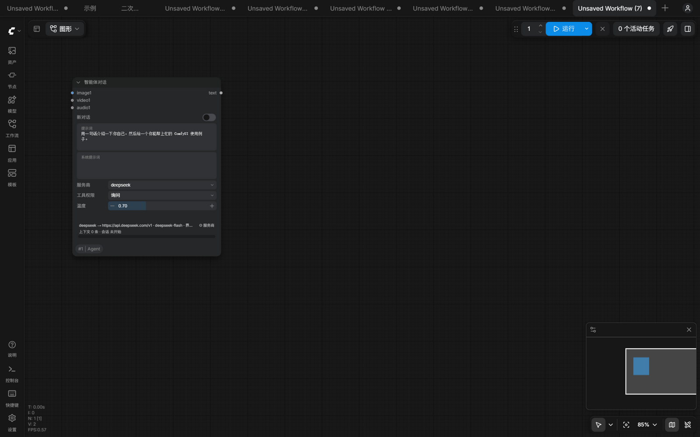
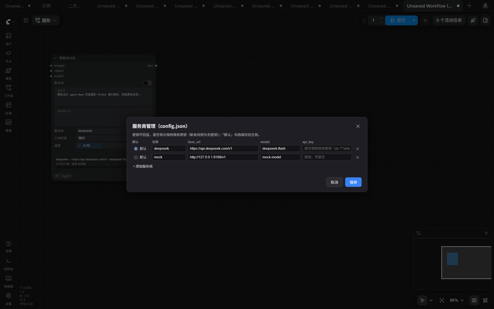
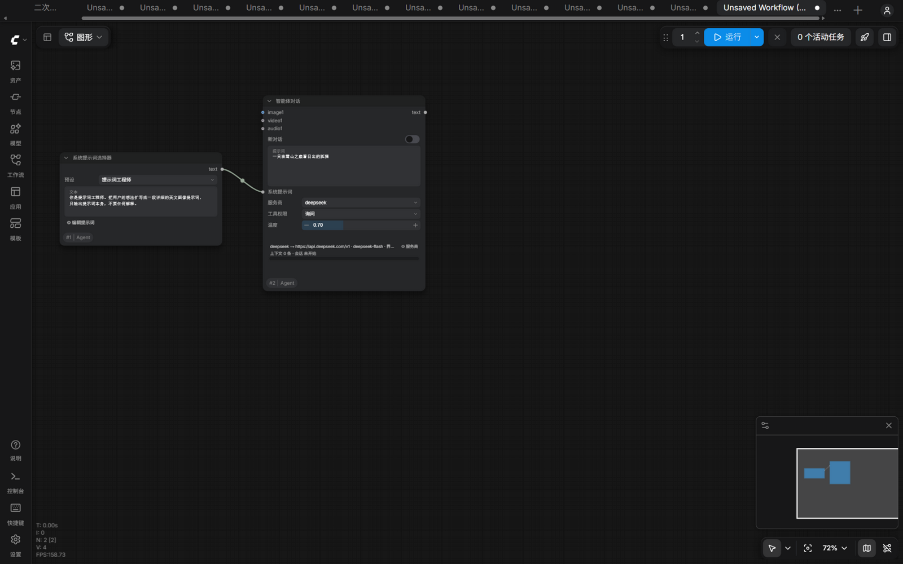
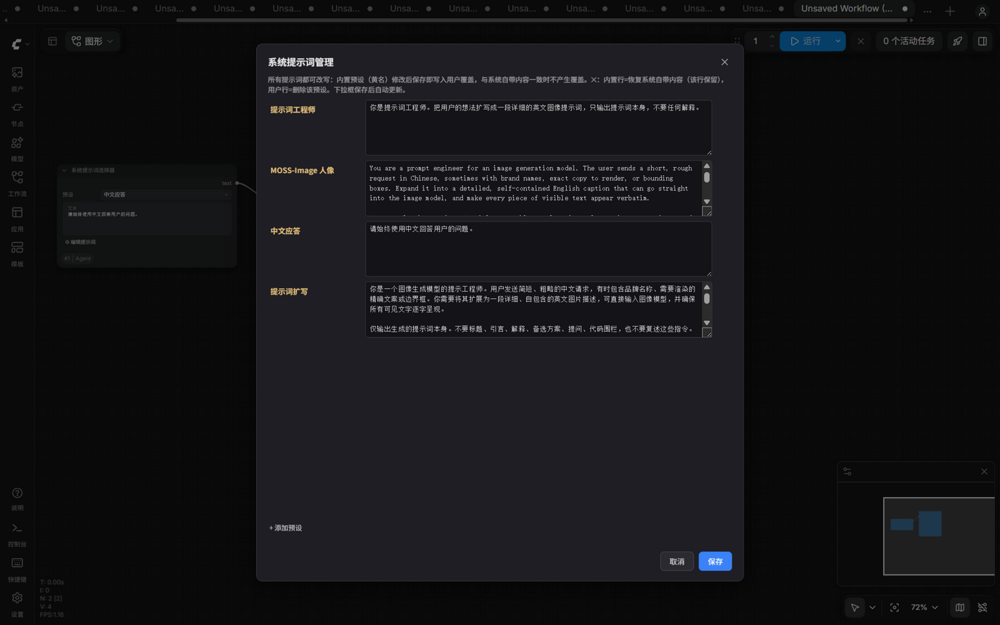
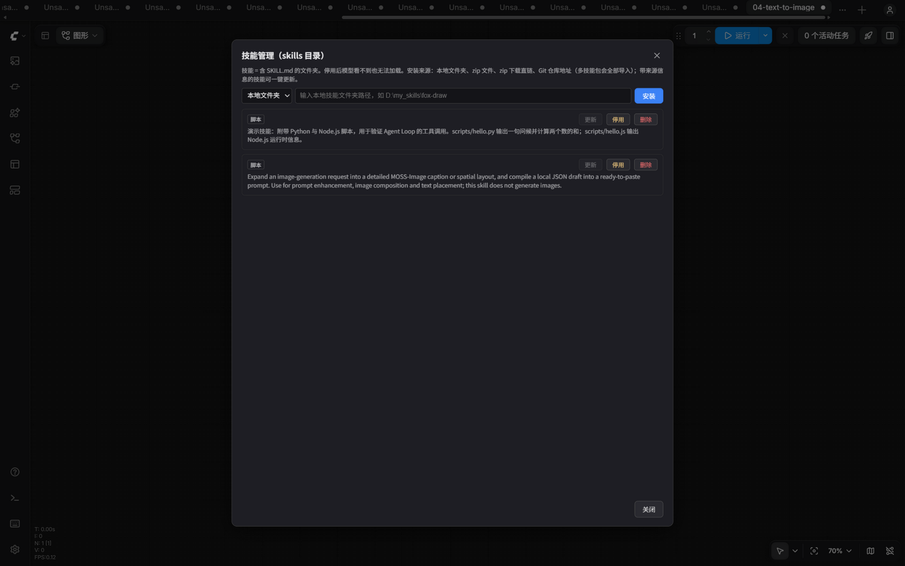
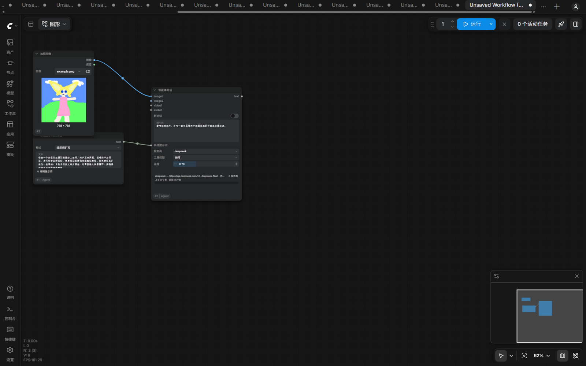
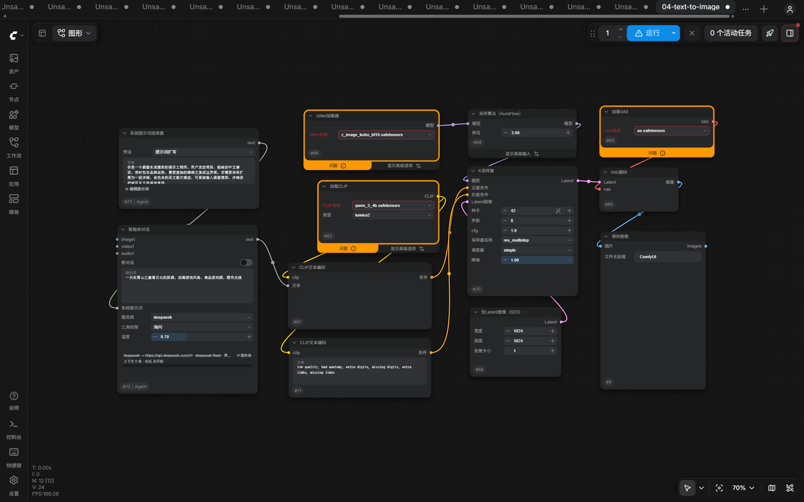

# ComfyUI_Agent

「智能体对话」（`AgentChat`）节点：通过任何 OpenAI 兼容 API（DeepSeek、智谱、Kimi、OpenAI、本地 Ollama / LM Studio / vLLM 等）与大模型对话，回复以 `STRING` 输出，可直接接入 `CLIP Text Encode` 等文本输入。带技能（Skill）系统、Agent 工具循环、权限审批、多模态输入，以及系统提示词预设与服务商的图形化管理弹窗。



## 快速开始

1. 把 `config.json.example` 复制为 `config.json`，填入至少一个服务商；或者启动后直接在节点上点「⚙ 服务商」图形化管理（见下节）。
2. 新建工作流，添加「智能体对话」节点，填入提示词，点击运行。回复显示在节点内，同时以 `STRING` 输出。

## 服务商管理

「智能体对话」节点信息行右侧的「⚙ 服务商」打开管理弹窗：增删改 providers 条目、设默认服务商。密钥不回显（仅显示掩码），输入框留空表示保持该条目现有密钥，新条目则为无密钥；已保存的密钥无法单独清除，如需移除密钥请删除整条记录后重新创建（直接手工编辑 config.json 亦可）。「+ 添加服务商」会自动滚动到底部并聚焦名称输入框。保存后本页所有 AgentChat 节点的服务商下拉框即时更新，无需重启或刷新。



`config.json` 支持任意数量的服务商，节点界面用「服务商」下拉框选择，base_url / api_key / model 全部由所选条目决定，界面不再手工输入：

```json
{
  "default": "deepseek",
  "providers": {
    "deepseek": {
      "base_url": "https://api.deepseek.com/v1",
      "api_key": "sk-...",
      "model": "deepseek-flash"
    },
    "zhipu": {
      "base_url": "https://open.bigmodel.cn/api/paas/v4",
      "api_key": "xxxx",
      "model": "glm-4.6"
    }
  }
}
```

- 修改 config.json 后刷新页面即可更新下拉框。
- 环境变量 `COMFYUI_AGENT_API_KEY` 覆盖所有已配置的密钥；密钥不是节点输入，不会存进工作流。

## 节点：智能体对话

- 技能**按需自动加载**，无需技能时不加载技能、不产生任何额外调用。
- 不支持 tool calls 的服务商自动回退为纯聊天模式（技能清单仍可见，但无法加载正文）。
- 工具调用轮次不进入会话记忆，仅最终回复进入。

输入（自上而下）：

- **新对话**：开关。打开后运行，提交瞬间即生成新会话 id 并自动复位为 false（同种子控件的策略），不会因开关复位产生多余的重复调用。
- **提示词**：本轮的指令或问题。
- **系统提示词**：可选，通常接「系统提示词选择器」节点。
- **服务商**：下拉框，见上。
- **工具权限**：bash / write / edit 的执行策略——**询问**（默认，执行前弹窗：允许 / 对话期间都允许 / 拒绝；超时 300 秒视为拒绝）、**总是允许**、**总是拒绝**。`read` 与 `load_skill` 是只读操作，不受影响。
- **温度**：0–2。
- **images / videos / audios**：动态输入组（连上 image1 后自动出现 image2，上限 12 / 5 / 5、总数 15）。视频每段均匀取 4 帧按图片发送；音频编码为 WAV（`input_audio`）；图片长边超过 1568px 自动等比缩小。目标模型需支持对应模态；媒体只在到达的那次运行中发送，对话记忆仅保留文本。
- **conversation_id**：隐藏的内部会话键，由节点自动铸造并管理；API 格式调用可显式设置，让多个节点共享同一对话。

会话记忆保存在服务器内存（重启清零，最多 100 个会话）。节点为输出节点，可独立运行纯聊天；执行遵循 ComfyUI 的输入缓存：输入未变化时复用缓存的回复而不调用 API，改动任意输入即触发新调用。

## 节点：系统提示词选择器

下拉框列出系统提示词合并视图（见下节）的各条目，选中后文本框实时带出全文（内容从服务器实时读取）；「(手工输入)」清空文本框自由编辑。节点上的「⚙ 编辑提示词」按钮打开管理弹窗：改写任意提示词（内置预设修改后保存即写入用户覆盖，与内置内容一致时不产生覆盖）、编辑/新增/删除用户预设——内置预设不可删：内置行不显示删除图标，被覆盖的内置行 ✕ = 恢复系统自带内容（该行保留），用户行 ✕ = 删除。「+ 添加预设」会自动滚动到底部并聚焦名称输入框。保存后本页所有选择器的下拉框与文本镜像自动更新，无需刷新页面。无输入，一个 `STRING` 输出，接「智能体对话」的「系统提示词」。





## 系统提示词文件

- 系统提示词分两份存放：内置预设 `system.default.json` 随插件更新；用户预设 `system.json` 不会被插件更新覆盖掉。
- 读取时合并为统一视图——内置条目补充用户没有的名称，重名以用户侧为准。
- 编辑弹窗的保存始终写入 `system.json`（对内置预设同名保存即生成用户覆盖版），删除用户的同名覆盖后自动回落到内置内容，内置预设本身不可删除。
- 文件改动即时生效，无需重启。

## Agent 工具循环

- Agent 支持 `read` / `write` / `edit` / `bash` 四个工具，工作区为插件根目录（系统消息会告知该路径与技能位置，避免全盘查找）。
- bash 在 Windows 上自动定位 Git Bash，缺失时下载 MinGit。
- `python` 即复用了 ComfyUI 的 Python。
- Node.js 脚本经 fnm 运行，fnm 缺失时自动安装到 `.runtime/fnm`。
- 每一次对话后大模型执行操作的轮次最多为 64 轮。
- 仅最终问答进入对话记忆，执行过程中的内容不会进入对话记忆。
- 执行过程中节点状态行实时显示当前轮次与工具命令。
- **目前还没有上下文压缩等上下文管理功能，请注意对话长度。**

## 技能管理

「智能体对话」节点信息行的「⚙ 技能」按钮打开管理弹窗：安装、停用/启用、更新、删除技能，不用手工维护 `skills/` 目录。

- 安装来源：本地文件夹、zip 文件、zip 下载直链、Git 仓库地址（多技能包会全部导入）。
- 停用后技能从模型可见的清单里消失，也无法被加载；随时可再启用。
- Git 方式安装的技能保留版本信息，更新只拉取增量、不用整包重下；如果本机改过技能文件，更新会先拒绝并提示，避免覆盖你的修改。
- 其它来源的技能按记录的路径/地址重新拉取整体替换。
- 删除为两步确认，删除后目录不可恢复。



## 示例工作流

`examples/` 内四个可直接拖入 ComfyUI 的示例（UI 格式，含布局与预填的提示词）：

| 文件 | 内容 |
| --- | --- |
| `01-basic-chat.json` | 最小对话：AgentChat 单节点独立运行 |
| `02-prompt-engineer.json` | 系统提示词选择器（提示词工程师）→ 智能体对话，输出可接 `CLIP Text Encode` |
| `03-image-to-prompt.json` | 图像提示词扩写：LoadImage → 选择器（提示词扩写）→ 对话，把图片转写为详细英文描述 |
| `04-text-to-image.json` | 智能体扩写提示词 → 官方最简文生图流程（UNETLoader / KSampler / VAEDecode / SaveImage）出图 |





## 界面语言

节点标题与描述走 ComfyUI 官方 i18n：`locales/zh/nodeDefs.json`（服务端 `/i18n` 聚合）。输入标签在 schema 中直接使用中文 `display_name`。

## 测试

`tests/mock_server.py` 是无依赖的 OpenAI 模拟服务器：

```
python tests/mock_server.py   # http://127.0.0.1:8189/v1
```

在 config.json 中加一个指向该地址的 `mock` 服务商，节点上选「服务商 = mock」即可无密钥跑通全流程。
